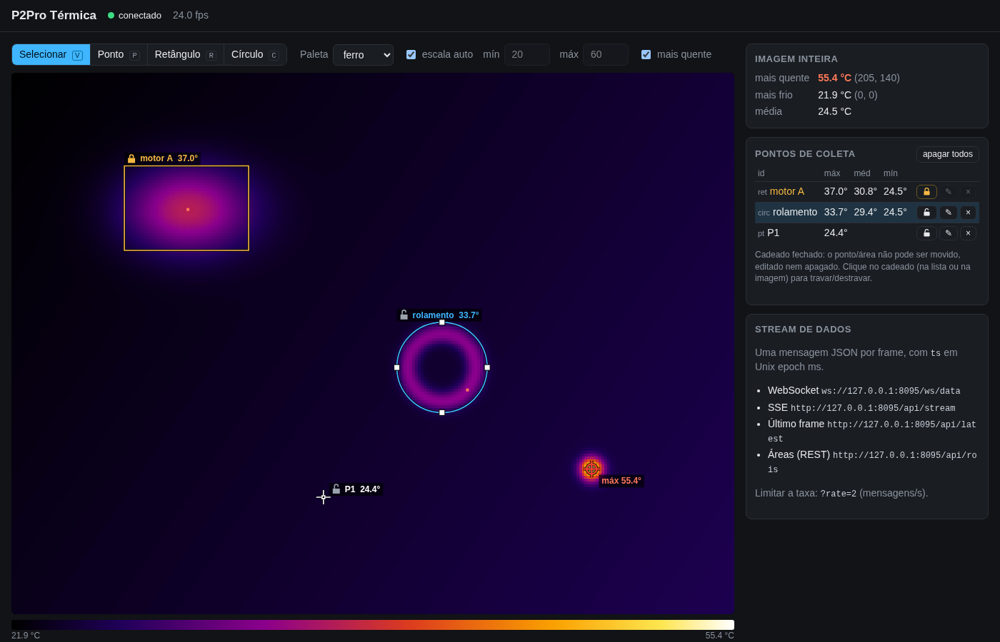

# P2ProLive

Live view and temperature data stream for the Infiray P2Pro thermal camera on Windows and Linux (no special drivers).



## Thermal server
`thermal_server.py` reads the camera at its full frame rate (25 fps) and offers:
- a browser UI with the live thermal image (colormaps, auto/manual scale, temperature under the mouse cursor)
- collection points/areas drawn on the image: point (pixel), rectangle (drag) or circle (drag the radius),
  each with a label/id. Select them to move (drag, arrow keys), resize (handles), rename (double click or the pencil
  in the list) or delete (x in the list or the Delete key)
- a lock per point/area (click the lock on the image or in the list): a locked one can not be moved, edited or deleted
- the hottest (and coldest) pixel of the whole image with position
- a **data stream** for other applications: one JSON message per frame with unix epoch timestamp in ms,
  the global values and every point/area with its geometry and values
- unplugging the camera: the server keeps running, reports it (UI and stream) and reconnects when the camera is back
- the UI in Portuguese, English or Spanish (browser language by default) and a dark or light theme that follows the
  system setting unless one is chosen; both are remembered per browser

```bash
source .venv/bin/activate          # or your conda env, see Installation
pip install -r requirements.txt
python thermal_server.py           # camera auto detected on Linux, otherwise --cam /dev/videoN (Windows: --cam 0)
# open http://127.0.0.1:8080
```
Options: `--host 0.0.0.0` makes the server reachable from other machines (**there is no authentication**, everybody
in the network can see the stream and create/delete areas), `--port`, `--rois <file>` (default `rois.json`, the areas
survive restarts), `--cam` (without it the camera is found by its USB id, also when it comes back under another
/dev/videoN after unplugging it). Only one program can stream from the camera at a time (close webcam apps like Cheese).

### Data stream
| what | how |
|---|---|
| WebSocket (push) | `ws://<host>:8080/ws/data` |
| Server-Sent Events (push, plain HTTP) | `http://<host>:8080/api/stream` |
| last message (polling) | `GET http://<host>:8080/api/latest` |
| full temperature image | `GET http://<host>:8080/api/frame` (`temps`: 192 rows x 256 columns, C) |
| server/camera status | `GET http://<host>:8080/api/status` |

The push streams send every frame (~25/s). Add `?rate=N` to get at most N messages per second
(e.g. `ws://127.0.0.1:8080/ws/data?rate=1`). A slow client skips frames, it never receives old data.

Frame message (one per frame):
```json
{
  "type": "frame",
  "ts": 1731420000123,
  "ts_source": "driver",
  "frame": 1234,
  "unit": "C", "width": 256, "height": 192,
  "global": {"min": 27.8, "max": 34.67, "mean": 31.4, "max_pos": {"x": 123, "y": 170}, "min_pos": {"x": 237, "y": 151}},
  "rois": [
    {"id": "P1", "type": "point", "x": 200, "y": 50, "locked": false, "temp": 32.01},
    {"id": "motor A", "type": "rect", "x": 40, "y": 30, "w": 40, "h": 30, "locked": true,
     "pixels": 1200, "min": 30.86, "max": 31.86, "mean": 31.34, "max_pos": {"x": 52, "y": 41}, "min_pos": {"x": 77, "y": 58}},
    {"id": "bearing", "type": "circle", "cx": 150.5, "cy": 100.5, "r": 10, "locked": false,
     "pixels": 317, "min": 32.0, "max": 32.4, "mean": 32.3, "max_pos": {"x": 151, "y": 97}, "min_pos": {"x": 141, "y": 103}}
  ]
}
```
- `ts`: unix epoch in milliseconds of the frame capture. `ts_source` `"driver"`: the camera driver (Linux V4L2) stamps
  each frame when its first data arrives, ~36 ms before the whole frame is received; converted to the wall clock of
  the computer. `"host"` (Windows, or no usable driver time): the time the frame was read. The camera itself has
  no clock with date and time, so the time always comes from the computer.
- coordinates are image pixels: `x` = column 0..255, `y` = row 0..191 (sensor orientation). Pixel (i, j) covers
  [i, i+1) x [j, j+1). A rect/circle contains the pixels whose center (i+0.5, j+0.5) lies inside it.
- temperatures in Celsius, rounded to 0.01. The camera works in the high gain mode (up to ~180 C).

Status message: sent when a client connects and whenever the camera is unplugged/plugged in or stops sending frames
for 2 s (no frame messages are sent while it is disconnected):
```json
{"type": "status", "ts": 1731420000123, "camera_connected": false, "camera": "/dev/video4", "error": "camera read failed: ..."}
```

Examples:
```bash
python client_example.py --rate 1 --csv log.csv            # python, see the file
curl -N http://127.0.0.1:8080/api/stream?rate=1            # SSE in the terminal
```
```js
const ws = new WebSocket('ws://127.0.0.1:8080/ws/data');   // browser / node
ws.onmessage = (ev) => {
  const m = JSON.parse(ev.data);
  if (m.type === 'status') console.log('camera connected:', m.camera_connected);
  else console.log(m.ts, m.global.max, m.rois);
};
```

### Collection points/areas over REST
Other applications can manage the areas too (the UI is updated live):
```bash
curl http://127.0.0.1:8080/api/rois                                                    # list
curl -X POST http://127.0.0.1:8080/api/rois -d '{"id":"motor A","type":"rect","x":40,"y":30,"w":40,"h":30}'
curl -X POST http://127.0.0.1:8080/api/rois -d '{"id":"bearing","type":"circle","cx":150.5,"cy":100.5,"r":10}'
curl -X POST http://127.0.0.1:8080/api/rois -d '{"type":"point","x":200,"y":50}'      # no id -> P1, P2, ...
curl -X PATCH "http://127.0.0.1:8080/api/rois/motor%20A" -d '{"x":50,"y":35}'           # move (URL encoded id)
curl -X PATCH "http://127.0.0.1:8080/api/rois/motor%20A" -d '{"w":20,"id":"motor B"}'   # resize and rename
curl -X PATCH "http://127.0.0.1:8080/api/rois/motor%20B" -d '{"locked":true}'           # lock (false: unlock)
curl -X DELETE "http://127.0.0.1:8080/api/rois/motor%20B"                               # delete one
curl -X DELETE http://127.0.0.1:8080/api/rois                                          # delete all unlocked
```
`PATCH` takes any of `id`, `locked` and the geometry keys of the type (`x`,`y` / `x`,`y`,`w`,`h` / `cx`,`cy`,`r`);
the type can not change. A locked point/area only accepts a change together with `"locked": false`.
Errors: 400 invalid definition (outside the image, w/h/r <= 0, ...), 404 id not found, 409 id already exists,
423 locked. An id has 1..64 characters (no control characters).

### Live view protocol
`ws://<host>:8080/ws/live` (used by the browser UI): the status messages and per frame the JSON frame message
followed by one binary message:
header `'<4sHHId'` (`b'P2PR'`, width, height, frame, ts_ms as float64) and width*height uint16 little endian raw values,
T[C] = raw/64 - 273.2.

## Installation
Windows (conda):
```powershell
conda create -n p2pro python
activate p2pro
pip install -r requirements.txt
```
Linux (venv):
```bash
python3 -m venv .venv
source .venv/bin/activate
pip install -r requirements.txt
```

## Credits
Based on [p2pro-live](https://github.com/ks00x/p2pro-live) by Klaus Schwarzburg (MIT License). The detection of the
camera by its USB id follows [P2Pro-Viewer](https://github.com/LeoDJ/P2Pro-Viewer) by LeoDJ (MIT License).
